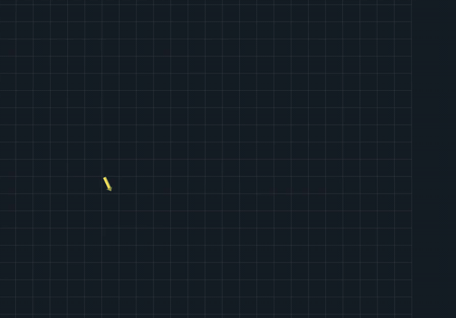
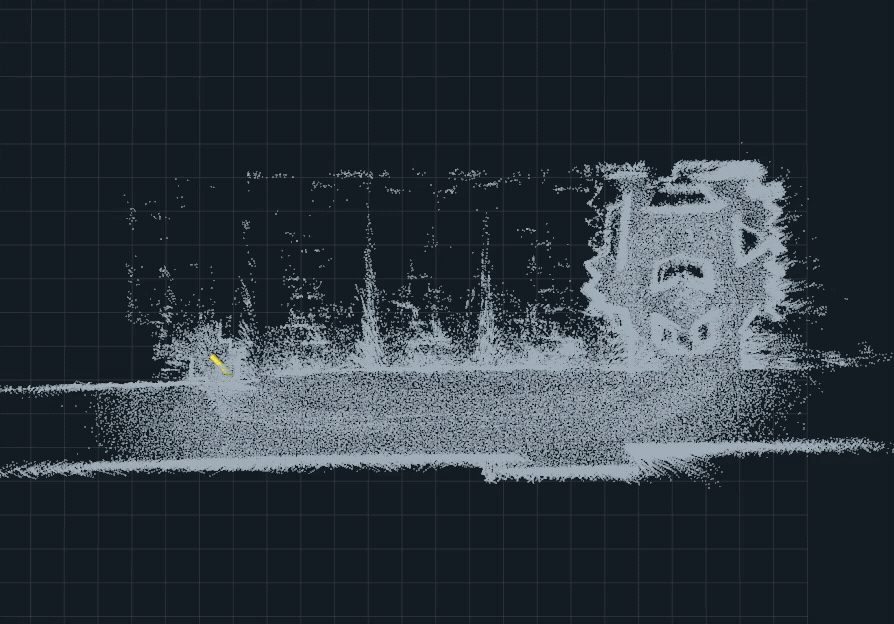
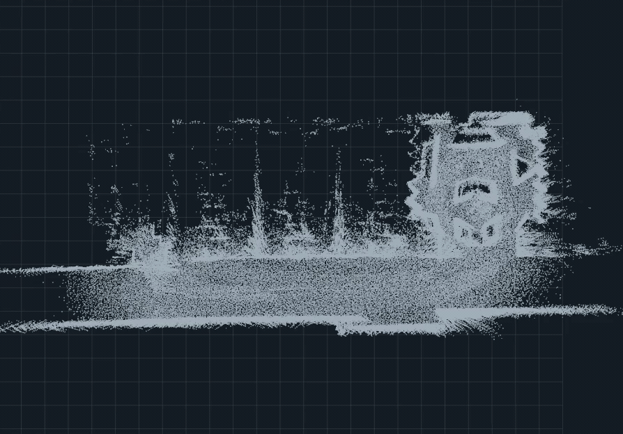

# MGTS Go2 · 3D-карта и локализация

В финальном решении GLIM строит 3D-карту A по лидару, IMU и кинематической одометрии. На проходе B трекер автоматически находит старт, прогнозирует движение по одометрии и уточняет позу по поверхностям карты методом point-to-plane ICP. Каждая поправка использует последние 1,6 с сканов.

На официальном B восстановлены все 1526 поз. Первая глобальная поза опубликована через 51,8 с вместе с историей начального участка. При воспроизведении 1× задержка p95 после привязки составила 20,1 мс. Независимый эталон траектории отсутствует.

**[Скриншоты и записи RViz](media/go2-final/)** · **[Финальный релиз с картой, маршрутом, ROS 2 bag и замерами](https://github.com/gozai7/mgts_doggy/releases/tag/go2-window-3d-final)**

```bash
make go2-live RUN_NAME=final-demo ARGS=--window-se3
```

Официальные бэги Go2, измеренные частоты, RViz и команды для прогона при 1× описаны в [инструкции по данным финала](docs/OFFICIAL_GO2.md).

Для переноса уже собранного образа выполните `make bundle-gpu`. Архив в `results/` содержит образ, конфиг и скрипт запуска. [Инструкция для ноутбука](docs/GPU_PORTABLE.md).

| Альтернативный профиль | Первый проход | Глобальная коррекция | Второй проход |
|---|---|---|---|
| GLIM | GLIM CPU GICP или GPU | Глобальный граф GLIM | lidar_localization_ros2 |
| RKO-LIO | RKO-LIO из закреплённого форка стека lidar_slam | graph_based_slam, GICP, геометрические проверки петель | Тот же localizer |

RKO-LIO здесь не подменён другой одометрией. Сначала frontend напрямую сохраняет deskewed-сканы
и соответствующую одометрию, затем отдельный offline backend оптимизирует граф и экспортирует
плотную исправленную траекторию и карту. Преимущество одной версии по точности не установлено.

## Маршруты в RViz

Вид сверху, ускорение 8×. Нажмите на анимацию, чтобы открыть запись в MP4.

### A · Построение карты

[](media/go2-final/01-RViz-A-mapping.mp4)

### B · Независимый проход GLIM

[](media/go2-final/02-RViz-B-GLIM.mp4)

### B · Локализация на готовой карте

[](media/go2-final/03-RViz-B-localization.mp4)

## Первый запуск

Хост: Linux x86_64, Docker Engine + Compose v2/v5. Ubuntu 22.04 на ноутбуке подходит как хост;
ROS 2 Jazzy и Ubuntu 24.04 находятся внутри контейнера. Системный Humble менять не нужно.
Практический ориентир для сборки — 16+ ГБ RAM, 30+ ГБ свободного диска; это запас, а не измеренный минимум.
Сборка требует интернета. Обработка по умолчанию идёт без сети. Собирать образы нужно до соревнования.

```bash
unzip competition-glim.zip         # либо competition-rko-lio.zip
cd competition-glim               # либо competition-rko-lio
mkdir -p data results
make build
make smoke-test
```

`smoke-test` генерирует небольшой асимметричный искусственный офис и действительно запускает
выбранный SLAM и localizer. Эталон синтетической сцены не подставляется в результаты алгоритма.
Тест может выявить ошибки интеграции; его прохождение не доказывает качество на реальном LiDAR.

Положите записи в `data/mapping/` и `data/localization/` (полные каталоги bag с metadata.yaml),
либо укажите другие пути внутри `/data`. Отдельный `.mcap` также читается адаптером.
Оригинальные данные примонтированы только для чтения.

```bash
make doctor
make doctor PHASE=localization
# Заполнить configs/competition/dataset.yaml по отчёту и измеренным калибровкам.
make prepare
make baseline             # необязательная независимая LiDAR-only одометрия KISS-ICP
make mapping
# Для неизвестного старта B оставить initial_pose: null, manual_initial_pose: false.
make localization
make occupancy
make evaluate
# При уже согласованной конфигурации все четыре этапа: make run-all
```

Не запускайте реальные данные с пустыми extrinsics/единицами/point_time: конфигурация намеренно
останавливается на неизвестных величинах. `doctor` работает до заполнения этих полей.
`prepare` только генерирует конфигурации и не сообщает об успешном SLAM.
Другой конфиг выбирается через `make mapping CONFIG=configs/competition/my_dataset.yaml`.
Каталоги хоста: `DATA_DIR=/absolute/bags RESULTS_DIR=/absolute/results make mapping`.
При изменении параметров выбирайте новый `output`, например `/results/run02`.

## Данные и системы координат

Описание всех полей и примеры: [docs/DATASET.md](docs/DATASET.md).
Трансформация `T_base_lidar=[x,y,z,qx,qy,qz,qw]` переводит точку LiDAR в base.
Единицы — метры; кватернион XYZW, единичной длины. Аналогично задаётся `T_base_imu`.
Нулевое смещение допустимо только как измеренная калибровка, автоматически оно не подставляется.
PointCloud2 нормализуется в XYZ SI и относительное поле `time` в секундах. При `mode: none`
поле времени не выдумывается, deskew отключается. Поправки времени применяются ровно один раз.

При пустом `localization.initial_pose` начальную позу корпуса вычисляет стек. Он накапливает сканы B в локальной системе первого скана, ищет кандидатов по всей горизонтальной проекции карты A методом BBS и уточняет их по 3D-карте с ICP. Отдельный скан проверяет совпадение. При близких оценках разных поз поиск продолжается, а при исчерпании записи возвращает ошибку. Высоту для уточнения подсказывает ближайшая по XY поза маршрута A. Режим рассчитан на одноэтажное помещение.

С найденной позы NDT повторно обрабатывает B с первого скана. В конфиге можно выбрать предиктор движения,
в том числе кинематическую одометрию или IMU. Отклонённые регистрации не превращаются в «успешные» позы.

## Результаты

При `output: /results/run01` файлы находятся на хосте в `results/run01/`.

| Путь внутри результата | Содержание |
|---|---|
| `mapping/map.pcd` | Глобально оптимизированная 3D-карта |
| `mapping/trajectory_raw.tum` | Одометрическая траектория base в локальной системе алгоритма |
| `mapping/trajectory_optimized.tum` | Исправленная траектория base в map |
| `mapping/trajectory.tum`, `trajectory.csv` | Та же исправленная траектория в общем формате |
| `mapping/trajectory_lidar.tum` | Позы физического LiDAR в map |
| `mapping/frames.json`, `config_resolved.yaml` | Frame-контракт и фактическая конфигурация |
| `localization/trajectory.tum`, `trajectory.csv` | Только принятые регистрации второго прохода |
| `localization/diagnostics.json`, `alignment_status.jsonl` | Принятие/отклонение регистраций и восстановление |
| `occupancy/map.yaml`, `map.pgm`, `occupancy_bag/` | 2D-карта и ROS nav_msgs/OccupancyGrid |
| `diagnostics/mapping/`, `diagnostics/localization/` | Bag Doctor JSON и Markdown |
| `diagnostics/metrics.json`, `system.json`, `report.md` | Метрики, версии и отчёт |
| `logs/`, `mapping/dump/` либо `mapping/backend/` | Логи и нативные результаты upstream |

TUM/CSV: `t x y z qx qy qz qw`; секунды исходной временной шкалы после поправок, метры, XYZW.
Числа времени в TUM double имеют ограничение точности возле больших Unix timestamps;
внутри адаптера и ROS-сопоставления используются целые наносекунды.
`complete.json` появляется только после проверки обязательных выходов; `failed.json` означает
частичный результат. При сбое локализации готовая карта сохраняется. Не смешивайте результаты разных запусков.

## CPU, GPU и просмотр

CPU — стандарт для обеих версий. На GLIM доступны профили `default_indoor`, `sparse_lidar`,
`cpu_only`, `gpu`, `no_point_time`; профиль и `mapping.mode` должны согласовываться.
RKO-LIO использует CPU; доступны indoor/sparse/cpu_only/no_point_time.

Только для GLIM, после установки совместимого NVIDIA Container Toolkit и драйвера на хосте:

```bash
make build-gpu
# dataset.yaml: mapping.mode: gpu; mapping.profile: gpu
make mapping COMPOSE='docker compose -f compose.yaml -f compose.gpu.yaml'
```

Образ использует CUDA 12.6. Проверено на RTX 3060 Laptop, драйвер 615.78.08, ROS 2 Jazzy. CPU-образ CUDA не требует.
RViz, PlotJuggler, GLIM offline viewer и ручная инициализация описаны в
[docs/VISUALIZATION.md](docs/VISUALIZATION.md); основной pipeline работает без GUI.

## Проверки и диагностика

```bash
python3 -m venv .venv
. .venv/bin/activate
pip install -r requirements-competition.txt
make test-unit
python tools/bag_doctor.py data/mapping --output results/doctor
python tools/perturb_bag.py data/mapping results/fault_imu_20ms \
  --topic /imu/data --header-shift-s 0.02 --seed 42
```

Сравнение траекторий требует явного `T_a_b`: системы отдельных SLAM-запусков обычно различаются.

```bash
python tools/compare_results.py results/a/mapping/trajectory_optimized.tum \
  results/b/mapping/trajectory_optimized.tum --T-a-b 0 0 0 0 0 0 1 \
  --output results/comparison.json
```

Identity в примере разрешён **только если системы уже совпадают**. Расхождение не равно абсолютной ошибке.
Дополнительные команды: [docs/DIAGNOSTICS.md](docs/DIAGNOSTICS.md).

## Исходная заготовка и дальнейшие шаги

Сохранены `solver/`, `sim/`, сценарии, Karto-патч, исходные тесты и исследования.
Старый 2D workflow вызывается через `make -f Makefile.legacy help/build/...`;
его контейнеры описаны в `Dockerfile.legacy` и `compose.legacy.yaml`.
Старые показатели в `benchmarks/` относятся к исходной 2D-системе, а не к GLIM/RKO.

Читайте [COMPETITION_RUNBOOK.md](COMPETITION_RUNBOOK.md), [ARCHITECTURE.md](ARCHITECTURE.md),
[KNOWN_ISSUES.md](KNOWN_ISSUES.md), [CHANGELOG.md](CHANGELOG.md),
[THIRD_PARTY.md](THIRD_PARTY.md) и `THIRD_PARTY.lock.json`.
Удалённые репозитории не изменялись; `.git` в архиве отсутствует.
