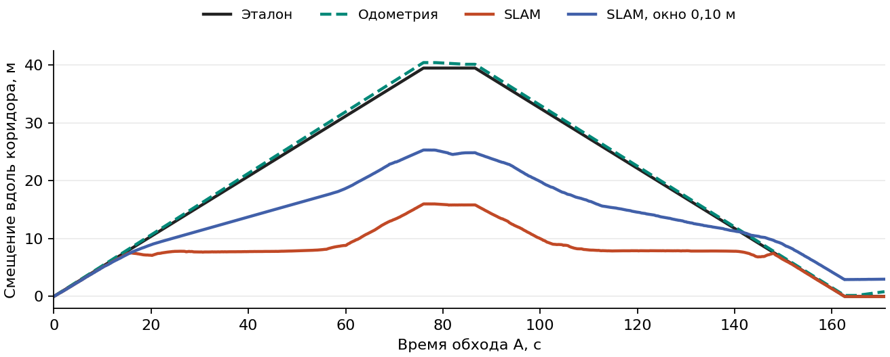

# Испытания локализации на известной карте

В каждой сцене отдельные записи обхода A и инспекции B. Карта строится по A через `slam_toolbox`, B начинается с другой позы. В основном испытании старт B неизвестен. Для каждого B чекер сравнивает AMCL и офлайн-уточнение на одной карте, по одному потоку одометрии и одним сканам. Эталон доступен чекеру. Система координат фиксируется первой позой A, без подгонки по B.

| Сцена | Длина A / B | Что проверяем |
|---|---:|---|
| [corridor](corridor/map.yaml) | 85 / 85 м | Две галереи длиной 44 м, дальность лидара 16 м. В середине скан одинаков при сдвиге вдоль коридора. Только у торцов появляется привязка по длине. |
| [colonnade](colonnade/map.yaml) | 202 / 168 м | Два ряда колонн с периодом 5 м. Скан подходит к нескольким пролётам. Инспекция длится 5 мин 38 с, асимметричный шкаф виден у восточного конца. |
| [eight](eight/map.yaml) | 88 / 85,6 м | Две петли вокруг похожих островов с повторными посещениями общей галереи. A и B обходят петли в разном порядке. |
| [atrium](atrium/map.yaml) | 90,8 / 81,2 м | Стеклянные перегородки, стены и колонны за ними. Маршрут проходит между перегородками и вдоль их обратной стороны. |
| [atrium-opaque](atrium-opaque/map.yaml) | 90,8 / 81,2 м | Тот же атриум с непрозрачными панелями. Положения, одометрия и реализация шума дальности совпадают с `atrium`. |

## Запуск

После `make build` выполните из корня репозитория, подставив имя сцены.

```bash
make bags SCENE=eight
make bench SCENE=eight
```

Первая команда создаёт `data/eight-{A,B}/` (rosbag2 MCAP) и `truth/eight-{A,B}/` (геометрия и позы, а для A также физический план в координатах мира). Вторая сохраняет карту в `runs/eight/`, маршрут и `report.json` в `runs/routes/eight/eight-B/`. Для повтора на построенной карте укажите новое имя, например `make bench SCENE=eight ROUTE=repeats/eight-2`. Для нового картографирования задайте свободный `MAP`. Для контрольного запуска с известным стартом в коридоре используйте `make bench SCENE=corridor ROUTE=repeats/corridor-known ARGS="--initial 12 3 0"`.

Пары `map.yaml` и `map.pgm` рядом с этим файлом — сохранённые результаты картографирования, включая неудачный результат для коридора. Чтобы локализоваться на конкретном сохранённом растре, скопируйте пару в новый каталог, например `runs/frozen-eight/`, и выполните `make localize MAP=frozen-eight B=eight-B ARGS="--profile /mgts/configs/planar.yaml --refine"`. Для расчёта абсолютных ошибок используйте `make bench`, который сохраняет также траекторию A.

## Какие данные подаются решателю

Фиксированные маршруты записывает плоский генератор. Он имитирует вращения на месте и движение до 0,52 м/с. Лидар снимает 360 дальностей на 360° с частотой 5 Гц и шумом 1,5 см. У одометрии ошибка масштаба расстояния +2,5 %, поворота +1 % и дрейф курса 0,001 рад/с. Начальная поза одометрии всегда локальный ноль. Для A и B заданы разные маршруты и разные фиксированные начальные состояния генератора шума. Эти bag содержат только `/scan` и `/odom`; модель шага Go2, крен, тангаж и IMU в эксперимент не входят.

В `atrium` ближайшая панель может вернуть луч преимущественно вблизи нормали. В остальных случаях записывается дальность до непрозрачного объекта за стеклом или пропуск. На маршруте B по сравнению с непрозрачным двойником 21,3 % всех лучей удлинились более чем на 30 см и ещё 10,0 % потеряли отражение. Это модель чувствительности к материалу с выбранными нами вероятностями. Она не воспроизводит зеркальные фантомы, последовательное взаимодействие с несколькими панелями и характеристики конкретного лидара. Угловую зависимость наблюдений описывают авторы VisAGGE. [Foster et al., ICRA 2013](https://web.eecs.umich.edu/~kuipers/papers/Foster-icra-13.pdf)

Эти же планы открываются в Gazebo для ручной записи Go2, например `make robot A=manual-hall SCENE=corridor`. Старт зависит от сцены и роли, его можно изменить через `--spawn X Y YAW`. Панели имеют коллизию и визуальную прозрачность. Вероятностная модель эха работает в `make bags`. [Планы](../configs/scenes/) · [Генератор измерений](../sim/scene_bags.py)

## Измеренные ошибки

Результаты одного глобального старта на каждой карте. RMSE и P95 положения даны в метрах. Покрытие B составило 100 % во всех пяти случаях. Генератор измерений детерминирован, AMCL использует случайные частицы. В таблице приведены прогоны со скоростью воспроизведения 3×.

| Сцена | RMSE траектории A | RMSE B, AMCL → уточнение | P95 B, AMCL → уточнение |
|---|---:|---:|---:|
| [Коридор](corridor/report.json) | 15,195 | 27,966 → 27,966 | 50,481 → 50,481 |
| [Колоннада](colonnade/report.json) | 0,354 | 2,387 → 0,399 | 5,068 → 0,642 |
| [Восьмёрка](eight/report.json) | 0,084 | 2,199 → 0,084 | 0,128 → 0,166 |
| [Атриум со стеклом](atrium/report.json) | 0,123 | 0,445 → 0,139 | 0,177 → 0,218 |
| [Атриум с непрозрачными панелями](atrium-opaque/report.json) | 0,093 | 0,900 → 0,116 | 1,487 → 0,167 |

На восьмёрке ошибка AMCL больше 1 м встречалась только в первые 2,6 с из 182,4 с. Последующие наблюдения помогают восстановить начало маршрута, но P95 после уточнения здесь вырос. В колоннаде чекер покрыл 73,0 % времени A, поэтому её RMSE относится к покрытой части. На B доступны все метки. В отдельном прогоне с повторным построением карты и глобальным стартом при 5× получилось 7,854 → 0,575 м на B. В том прогоне AMCL ошибался больше чем на метр и в конце инспекции. Изменились карта и инициализация частиц, поэтому разницу между прогонами нельзя приписать только скорости воспроизведения. [Прогон при 5×](colonnade/report-5x.json)

В опыте со стеклом P95 уточнённой траектории вырос с 0,167 до 0,218 м, а IoU занятых ячеек относительно физического плана снизился с 0,412 до 0,362. Отдельные A и B содержат стеклянные измерения, поэтому разность включает влияние стекла и на построение карты, и на локализацию. Для разделения эффектов можно воспроизвести оба B на одной сохранённой карте.

### Где ломается коридор

При истинном продольном размахе траектории A в 39,5 м стандартный `slam_toolbox` восстановил всего 16,0 м. В средней части даже идеальный единичный скан даёт одни и те же дальности при разных продольных координатах. Уточнение посчитало конкурирующие маршруты неоднозначными и сохранило результат AMCL.



Для следующих контрольных запусков старт B известен. Запись, материал, одометрия и положение старта одни и те же. В первых трёх строках менялась настройка картографа при съёмке A. В последней использован идеальный растр из геометрии симулятора.

| Что подали локализатору | Размах A вдоль коридора | RMSE траектории A | RMSE B, AMCL → уточнение |
|---|---:|---:|---:|
| [Обычная карта](corridor/known-start.json) | 16,0 м | 15,20 м | 4,45 → 4,45 м |
| [Карта с `do_loop_closing: false`](corridor/no-loop.json) | 18,5 м | 13,55 м | 17,22 → 4,82 м |
| [Карта с `correlation_search_space_dimension: 0.10`](corridor/narrow.json) | 25,3 м | 8,82 м | 25,69 → 3,34 м |
| [Точный физический план](corridor/ideal.json) | — | — | 0,119 → 0,042 м |

Одна и та же одометрия с точным стартом дала 1,116 м RMSE на B. Отключение замыканий не восстановило длину. Сужение окна локального поиска помогло частично. Переход на точный план при том же bag дал наибольшую разницу. Для повторения контрольных опытов с картографом задайте указанный параметр в `configs/mapping.yaml` до `make map`, выбирая отдельный `MAP` для каждой конфигурации. Обоим локализаторам задаётся `--initial 12 3 0` на построенной карте или `--initial -8 1.5 0` на физическом плане из `truth/corridor-A/` в координатах мира.

**Следующая алгоритмическая гипотеза для A** — оценивать, в каких направлениях соседние сканы действительно ограничивают движение. Вдоль гладких стен сохранять приращение одометрии, поперёк и по курсу использовать геометрию лидара. Проверять отдельно продольный размах A, поперечную ошибку и ошибку B на построенной карте. Метод анализа слабых направлений описан у Zhang, Kaess и Singh. [On Degeneracy of Optimization-Based State Estimation Problems](https://www.cs.cmu.edu/~kaess/pub/Zhang16icra.pdf)

**Для периодических колонн** требуется другая проверка. Возле каждой колонны поперечная и продольная привязки могут быть резкими, но похожие максимумы повторяются каждые 5 м. Здесь имеет смысл сохранять несколько вариантов номера пролёта и проверять их последовательностью сканов после появления асимметричного ориентира. Это классический случай многомодальной глобальной локализации. [Fox, Burgard, Thrun, Markov Localization for Mobile Robots in Dynamic Environments](https://www.cs.cmu.edu/afs/cs/project/jair/pub/volume11/fox99a-html/jair-localize.html)
