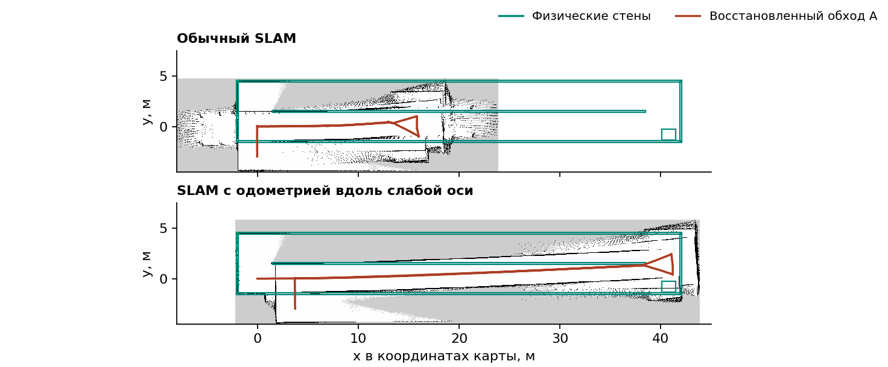

# Одометрия в слабо наблюдаемом направлении

Проверяли одну замену в картографе A. В штатном режиме Karto уточняет две координаты и курс по совпадению скана с предыдущими наблюдениями. В экспериментальном режиме он сохраняет приращение одометрии вдоль направления, в котором скан почти одинаков при смещении. B обрабатывает тот же AMCL с тем же офлайн-уточнением на сохранённой карте. Режим включается флагом `--directional-odom` при построении A.

## Что изменилось в Karto

Из соседних дальностей скана берём короткие отрезки наблюдаемых поверхностей. Для каждого вычисляем единичную нормаль в координатах карты. Сумма матриц `n nᵀ` характеризует чувствительность геометрии к сдвигу. Если есть хотя бы 20 подходящих отрезков и меньшее собственное значение ниже 8 % большего, собственный вектор меньшего значения принимается за слабую ось. Условия одинаковы во всех сценах.

До записи вершины и рёбер графа картограф проецирует поправку scan matching на поперечную ось. Вдоль слабой оси остаётся предсказание из предыдущей исправленной позы и приращения одометрии. Проекция выполняется для базы робота с учётом смещения лидара. Курс сохраняется из scan matching. Продольная дисперсия ограничения имеет нижнюю границу (5 см)². По такому скану картограф также отклоняет привязку к несмежной цепочке и замыкание петли, поскольку совпадение не задаёт продольной координаты. Счётчик `directional_updates` в `run.json` показывает число последовательных сопоставлений с этой поправкой. [Реализация](../../solver/karto/directional.hpp) · [Место изменения в Karto 2.8.5](https://github.com/SteveMacenski/slam_toolbox/blob/ec8f7635dea317b531c419f798f87d90a336f32e/lib/karto_sdk/src/Mapper.cpp#L535) · [Работа о вырожденных направлениях в оценке движения](https://www.cs.cmu.edu/~kaess/pub/Zhang16icra.pdf)

## Как сравнивали

- **Парный эксперимент** (`matched`). Сначала обычным картографом обработали A. Обеим версиям передали одинаковые сканы по меткам ключевых кадров этого прогона. Для воспроизведения [сохранены только метки времени](keyframes/), координаты из опорного графа в решатель не подаются. Следующий ключевой кадр передаётся после подтверждения позы предыдущего. При экспорте проверяется совпадение наборов меток и отсутствие дубликатов. Обе версии независимо построили сетку и траекторию. B стартует глобально на каждой карте. Отдельно в коридоре и колоннаде повторили B с известным стартом.
- **Обычный запуск** (`ordinary`). Оба картографа независимо проиграли полные A с ускорением 3×. На каждой из полученных карт выполнили три запуска B с одинаковыми входами. При асинхронном проигрывании ROS может отбросить разные кадры. На восьмёрке при нуле срабатываний детектора это дало 0,085 и 0,051 м RMSE. При фиксированных кадрах растр и обе ошибки совпали. Три запуска на одной карте характеризуют повторяемость на этом bag.
- В пяти испытаниях измерения синтезированы плоским генератором. В шестом использованы записи Go2 из Gazebo, включая EKF робота. Эталон читает чекер. Система координат задаётся первой позой A. [Сцены и модель измерений](../README.md) · [Все результаты отдельных прогонов](results.csv)

## Результат на одинаковых кадрах

RMSE и P95 даны в метрах. Стрелка идёт от штатного картографа к экспериментальному. Колонка B включает офлайн-уточнение. В CSV отдельно приведены ошибки исходного AMCL, курса, покрытие, IoU занятых ячеек и ошибка конца обхода A.

| Сцена | Срабатывания / кадры A | RMSE A | RMSE B | P95 B |
|---|---:|---:|---:|---:|
| Длинный коридор | 574 / 852 | 15,195 → 2,650 | 27,966 → 5,488 | 50,481 → 15,330 |
| Колоннада | 894 / 1495 | 0,536 → 0,655 | 3,770 → 0,727 | 0,995 → 1,118 |
| Восьмёрка | 0 / 935 | 0,083 → 0,083 | 0,085 → 0,085 | 0,163 → 0,163 |
| Стеклянный атриум | 2 / 915 | 0,111 → 0,111 | 0,125 → 0,124 | 0,196 → 0,202 |
| Непрозрачный атриум | 63 / 932 | 0,088 → 0,085 | 0,106 → 0,104 | 0,161 → 0,149 |
| Офис Go2 | 0 / 149 | 0,041 → 0,041 | 0,041 → 0,041 | 0,061 → 0,061 |

Покрытие времени B составило 100 % во всех строках. Для траектории A чекер пропускает большие интервалы между ключевыми кадрами. В колоннаде он покрыл 79,2 % времени, в офисе Go2 — 51,7 %. При парном сравнении покрытие A совпадает между версиями в каждой сцене.

**Где есть регрессия.** В колоннаде ошибка карты по траектории A выросла с 0,536 до 0,655 м. При глобальном старте ошибка исходного AMCL выросла с 3,808 до 30,349 м, а RMSE курса достигла 179°. Офлайн-уточнение исправило выбор направления. В штатном стеке итоговая ошибка превышала 5 м только на первых 12,2 с, поэтому удаление крупной начальной ошибки улучшило RMSE даже при ухудшении P95 с 0,995 до 1,118 м. В обычном асинхронном прогоне итоговый RMSE колоннады также немного вырос (0,586 → 0,619 м). В дополнительной паре с известным стартом колоннады (15,5 м, 0, 0 в координатах карты, одинаковое воспроизведение B при 6×) итоговый RMSE вырос с 0,584 до 0,720 м. Это показывает цену новой карты после снятия неопределённости старта. В стеклянном атриуме P95 вырос на 6 мм. На восьмёрке и в офисе Go2 растры при фиксированных кадрах побайтно совпали.

На непрозрачном атриуме RMSE маршрута почти та же, но IoU занятых ячеек снизился с 0,419 до 0,372. Поэтому экспериментальный режим оставлен явной опцией для построения отдельной карты. Все показатели относятся к включённым вместе проекции последовательной поправки и проверке несмежных связей.

### Что в коридоре действительно восстановилось

| Метрика | Эталон | Штатный | С продольной одометрией |
|---|---:|---:|---:|
| Размах траектории A вдоль коридора, м | 39,50 | 16,04 | 41,20 |
| Продольный размер по растру, м | 44,15 | 25,65 | 45,85 |
| Ошибка конечной позиции замкнутого A, м | 0 | 2,97 | 4,77 |
| IoU занятых ячеек | 1 | 0,139 | 0,095 |
| RMSE B с известным стартом, м | 0 | 4,445 | 1,196 |

Для размера растра взяли 40 горизонтальных сечений внутри двух галерей (мировой y от −2,5 до −0,6 м и от 0,6 до 2,5 м с шагом 0,1 м) и медиану расстояний между крайними занятыми ячейками. Эталонный растр оценён так же. Расстояние между центрами торцевых стен в описании мира равно 44 м. На обратном ходе остаётся поперечное расхождение. Поэтому восстановление длины и уменьшение RMSE B здесь сочетаются с худшим замыканием и меньшим IoU. При известном старте одна одометрия дала 1,116 м RMSE.



В обычном запуске на свободно поступающих сканах размах A составил 16,04 → 40,13 м, RMSE B — 27,97 → 1,34 м. При отборе одинаковых кадров выигрыш сохраняется, но ошибка B заметно зависит от карты. Из одного физического маршрута нельзя вывести ожидаемую точность для здания МГТС.

## Воспроизвести

После `make build` и `make bags SCENE=corridor` из корня проекта:

```bash
make compare SCENE=corridor    # новый парный эксперимент, отдельный каталог runs/compare-corridor.*
make bench SCENE=corridor DIRECTIONAL=1    # обычное проигрывание A, карта corridor-directional
```

Подставьте `colonnade`, `eight`, `atrium` или `atrium-opaque` для других синтетических сцен. Для `make compare SCENE=office` нужны `office-A` и `office-B` из [релиза с записями Gazebo](https://github.com/gozai7/mgts_doggy/releases/tag/simulation-data-v1). Команда `compare` печатает пути к обоим отчётам. Файлы карт, графов и траекторий остаются рядом с ними.
