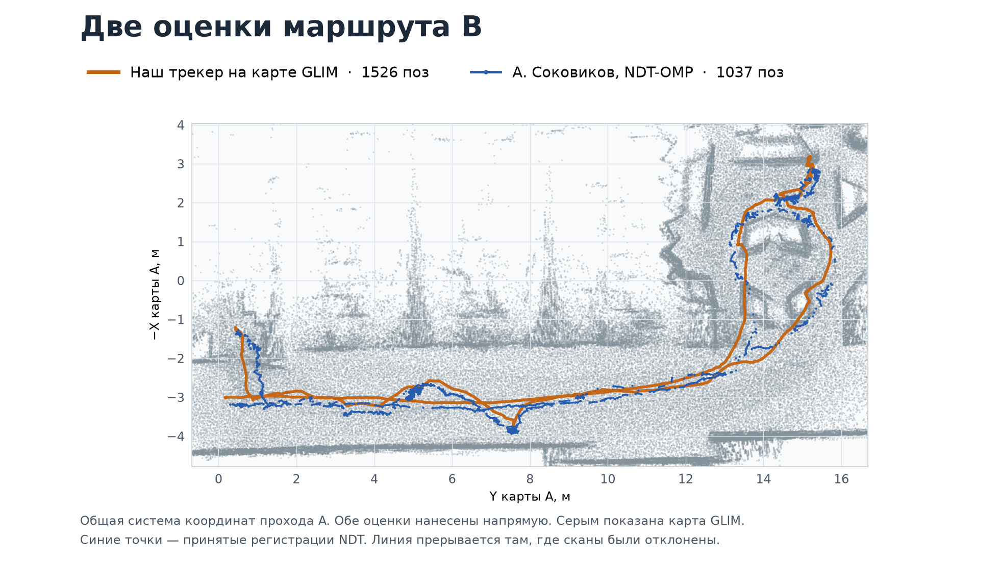

# Материалы финального прогона Go2

Оранжевая линия показывает локализацию B на сохранённой 3D-карте A. [Скриншот сверху, весь маршрут](RViz-top.png) · [Скриншот от третьего лица, поворот на 74-й секунде](RViz-third-person.png)

| Что показано | GIF без интерфейса | Запись RViz |
|---|---|---|
| Синий путь A и накопление карты по мере поступления измерений | [GIF](01-RViz-A-mapping.gif) | [MP4](01-RViz-A-mapping.mp4) |
| Фиолетовый путь B, независимо восстановленный GLIM и совмещённый с A | [GIF](02-RViz-B-GLIM.gif) | [MP4](02-RViz-B-GLIM.mp4) |
| Оранжевый путь B на карте A, включая восстановление начала при первой привязке | [GIF](03-RViz-B-localization.gif) | [MP4](03-RViz-B-localization.mp4) |

Все три анимации показывают записанные результаты сверху с ускорением 8×.

### Сравнение двух решений на официальном B

Оранжевая траектория содержит 1526 поз, включая восстановленное начало и прогнозы по одометрии. У Александра Соковикова NDT-OMP на карте из штатных облаков A сохранил 1037 подтверждённых поз. На общих временных метках медианное расхождение двух траекторий в плане составило 0,25 м, p95 — 0,59 м. Обе показаны в системе одометрии A без дополнительной подгонки по B. [Отчёт Соковикова](https://github.com/gozai7/mgts_doggy/blob/bd2beaecc7e84541b7801413a65263f7b1513620/TEST_REPORT.md)

